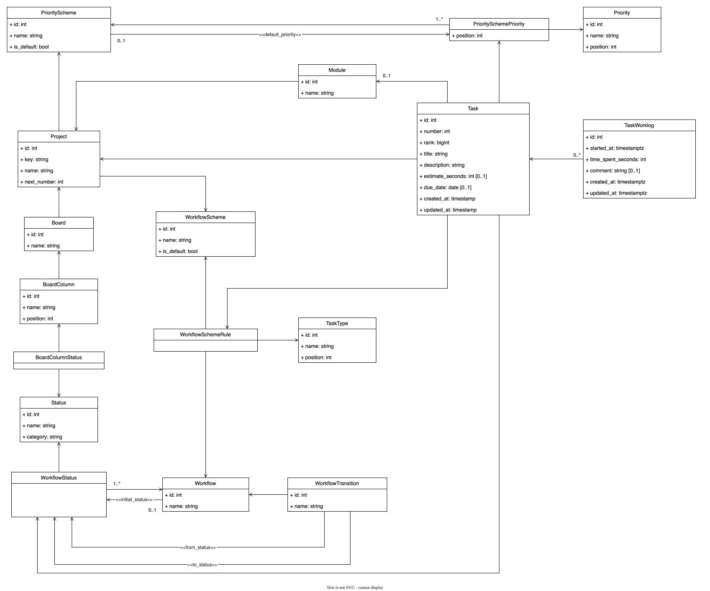

# Основные понятия

Задача описывает работу, которую нужно выполнить.
Связанные задачи объединяют в [проекты](#project),
а за их продвижением следят на [досках](#boards).

## Проект {#project}

Проект объединяет задачи одного продукта или направления работы,
например развития интернет-магазина.
Внутри проекта [модули](#module) помогают разделить работу по частям продукта,
а доски показывают её ход.
Общие [справочники](#catalog) задают доступные типы задач,
статусы и приоритеты.

## Задача {#task}

Задача описывает работу, которую нужно выполнить, например исправить ошибку или добавить фильтр товаров.
Она относится к проекту,
а её продвижение от начала работы до завершения отражают [статусы](#status).
Правила перехода между ними определяет [процесс выполнения](#workflow).

Для обсуждения задачи удобно использовать её ключ, например `WEB-12`.
Он складывается из ключа проекта `WEB` и номера задачи `12` внутри этого проекта.

## Модуль {#module}

Модуль объединяет задачи одной части продукта внутри проекта.
Например, в проекте интернет-магазина модуль Каталог объединяет работу над поиском
и карточками товаров, а модуль Оплата — над оформлением платежей.

## Тип задачи {#task-type}

Тип описывает характер работы, которой посвящена задача.
Например, исправление ошибки и добавление новой возможности могут относиться к разным типам:

| Тип | Пример задачи |
| --- | --- |
| `Task` | Добавить фильтр по цене |
| `Bug` | Исправить фильтр, который пропускает товары дороже указанной цены |
| `Story` | Дать покупателю возможность подобрать товар по бюджету |
| `Epic` | Улучшить поиск товаров |

В проекте тип связан с [процессом выполнения](#workflow),
по которому задача проходит от начала до завершения работы.

## Приоритет {#priority}

Приоритет выражает относительную важность задачи
и помогает решить, чему уделить внимание в первую очередь.
Например, ошибке, которая мешает оплатить заказ, можно дать более высокий приоритет,
чем доработке внешнего вида каталога.

## Статус {#status}

Статус показывает, на каком этапе находится задача.
Например, `Open` означает, что работа ещё не начата,
`In Progress` — что она выполняется, а `Done` — что завершена.
Порядок смены статусов задаёт процесс выполнения.

## Процесс выполнения {#workflow}

Процесс выполнения, или workflow, описывает путь задачи
через статусы.
Он определяет, с какого статуса начинается работа
и какие [переходы](#transition) доступны на каждом этапе.

Например, стандартный процесс ведёт задачу из `Open` через `In Progress` в `Done`.
Он также позволяет вернуть её в `Open`, если работу нужно отложить или возобновить.

## Переход {#transition}

Переход — действие, которое переводит задачу
из одного статуса в другой в рамках её процесса выполнения.
Например, действие `Start progress` переводит задачу из `Open` в `In Progress`,
а `Complete` — из `In Progress` в `Done`.

## Справочник {#catalog}

Справочник содержит общие значения для задач проекта.
Например, справочник [типов](#task-type) определяет, какие виды работы различают в проекте,
а справочники статусов и [приоритетов](#priority)
позволяют одинаково обозначать этапы работы и её важность.

## Доска {#boards}

Доска показывает задачи одного проекта,
распределённые по [колонкам](#column) в зависимости от статуса.
Так можно увидеть, какая работа ожидает начала, выполняется или уже завершена.

В проекте может быть несколько досок с разной группировкой статусов.
Одна и та же задача может отображаться на нескольких досках.

## Колонка {#column}

Колонка объединяет задачи в одном или нескольких [статусах](#status) на доске.
Например, одна доска может показывать `Open` и `In Progress` раздельно,
а другая — объединять их в колонку Незавершённые.

## Оценка и срок {#planning}

Оценка трудозатрат показывает, сколько времени предполагается потратить на задачу,
а срок — к какой дате нужен результат.
Например, на исправление ошибки можно отвести час
и запланировать завершение к понедельнику.

## Схема данных {#data-model}

